# 技术预研事项规划

## 📋 1. 预研开发任务概览

### 1.1 任务优先级矩阵

| 任务阶段 | 任务性质             | 所属模块 | 一级菜单     | 二级菜单                  | 功能点                                                     | 预计工时 | 优先级 |
| ---------- | ---------------------- | ---------- | -------------- | --------------------------- | ------------------------------------------------------------ | ---------- | -------- |
| 第一阶段 | 🔴 重要且紧急           | 数据中台 | 框架升级     | 组件版本升级验证          | 一期大数据组件版本升级方案、技术验证                       | 9.5人/天 | 高     |
| 第一阶段 | 🟡 重要不紧急           | 数据中台 | 实时数仓     | Flink+kafka实时数仓       | 实时数据采集到数据湖代码服务实现                           | 5人/天   | 高     |
| 第一阶段 | 🟡 重要不紧急           | 统一门户 | 临时用户管理 | 临时用户管理              | 完成统一门户临时用户管理功能需求实现                       | 3.5人/天   | 中     |
| 第二阶段 | 🟡 重要不紧急           | 数据中台 | 数据应用     | Doris基础操作服务接口实现 | Doris部署安装，完成python服务框架代码搭建                  | 4人/天   | 中     |
| 第三阶段 | 🟡 重要不紧急           | 技术中台 | 统一查询     | 分布式查询引擎            | Trino/Presto分布式查询引擎，完成选型对比，完成基础功能验证 | 3人/天   | 中     |
| 第三阶段 | 🔵 不重要不紧急但需实现 | 数据中台 | 基础技术组件 | hbase部署并做基础预研开发 | 完成hbase的部署、完成基础功能使用实现                      | 3.5人/天   | 低     |

**总计预估工时：28.5人/天**

### 1.2 执行时间线

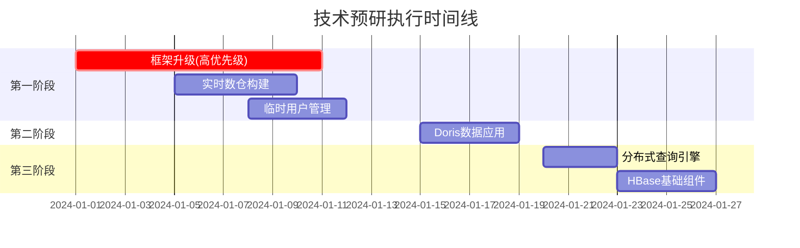

---

## 🚀 2. 第一阶段：框架升级（重要且紧急）

### 2.1 背景说明

根据政务云安全扫描结果，现有组件存在多个安全漏洞，需要进行版本升级以提升系统安全性和稳定性。

### 2.2 升级风险评估

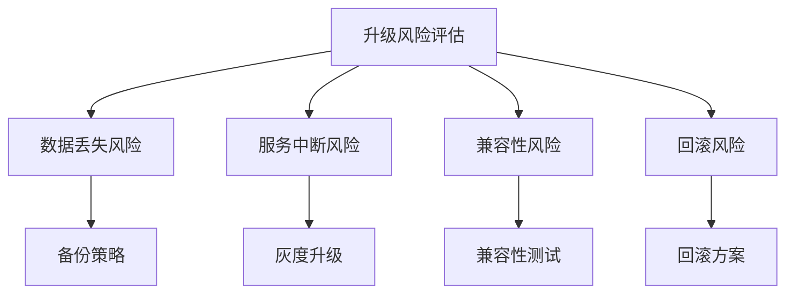

### 2.3 具体升级任务

#### 2.3.1 Hadoop 3.3.3 → 3.4.0

**工时计划：** 3人/天

**升级流程：**


**预研事项：**

- [ ] **平台操作掌握**
  - 掌握datasophon平台Hadoop组件升级方案
  - 熟悉升级界面操作流程
  
- [ ] **方案制定**
  - 记录详细的升级方案步骤和回滚方案
  - 制定升级前检查清单
  
- [ ] **兼容性验证**
  - 验证与现有Hive、Spark等组件的兼容性
  - 测试HDFS、YARN、MapReduce核心功能
  
- [ ] **性能测试**
  - HDFS读写性能对比测试
  - YARN资源调度性能验证

**测试案例：**
```bash
# HDFS功能测试
hdfs dfs -put /tmp/test_data /user/test/
hdfs dfs -ls /user/test/
hdfs dfs -cat /user/test/test_data

# YARN作业提交测试
yarn jar $HADOOP_HOME/share/hadoop/mapreduce/hadoop-mapreduce-examples-*.jar pi 10 100
```

**成果交付物：**
- Hadoop升级操作手册
- 兼容性测试报告
- 性能对比分析报告

#### 2.3.2 Hive 3.1.0 → 3.1.3

**工时计划：** 1.5人/天

**升级重点关注：**

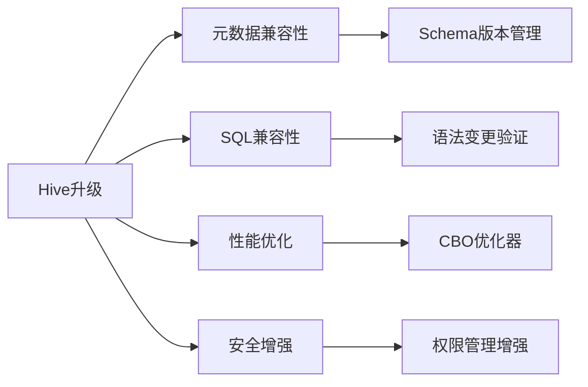

**预研事项：**

- [ ] **升级方案制定**
  - 掌握datasophon平台Hive组件升级方案
  - 制定元数据备份和恢复策略
  
- [ ] **兼容性测试**
  - 验证与Hadoop生态的兼容性
  - 测试Hive on Spark和Spark on Hive稳定性
  
- [ ] **功能验证**
  - SQL语法兼容性测试
  - ACID事务功能验证

**测试案例：**
```sql
-- 创建测试表
CREATE TABLE test_table (
    id INT,
    name STRING,
    create_time TIMESTAMP
) STORED AS PARQUET;

-- 插入测试数据
INSERT INTO test_table VALUES (1, 'test', current_timestamp());

-- 复杂查询测试
SELECT 
    name,
    count(*) as cnt,
    max(create_time) as latest_time
FROM test_table 
WHERE create_time > '2024-01-01'
GROUP BY name;
```

**成果交付物：**
- Hive升级操作手册
- 性能对比测试报告
- 元数据迁移方案

#### 2.3.3 Zookeeper 3.5.10 → 3.7.2

**工时计划：** 1人/天

**依赖关系图：**

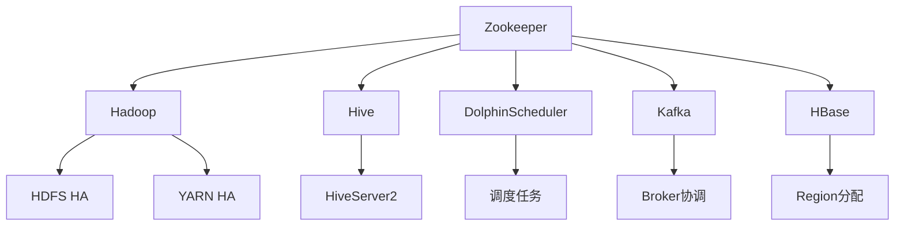

**预研事项：**

- [ ] **升级策略**
  - 掌握datasophon平台Zookeeper升级方案
  - 制定滚动升级策略
  
- [ ] **依赖组件验证**
  - 验证Hadoop、Hive等组件的连接稳定性
  - 测试集群选举和故障恢复机制

**测试验证：**
```bash
# 连接测试
zkCli.sh -server localhost:2181

# 集群状态检查
echo stat | nc localhost 2181
echo ruok | nc localhost 2181

# 依赖组件连接测试
hdfs haadmin -getServiceState nn1
yarn rmadmin -getServiceState rm1
```

**成果交付物：**
- Zookeeper升级操作手册
- 依赖组件兼容性测试报告

#### 2.3.4 Grafana 9.1.6 → 11.4.3

**工时计划：** 2人/天

**升级影响评估：**

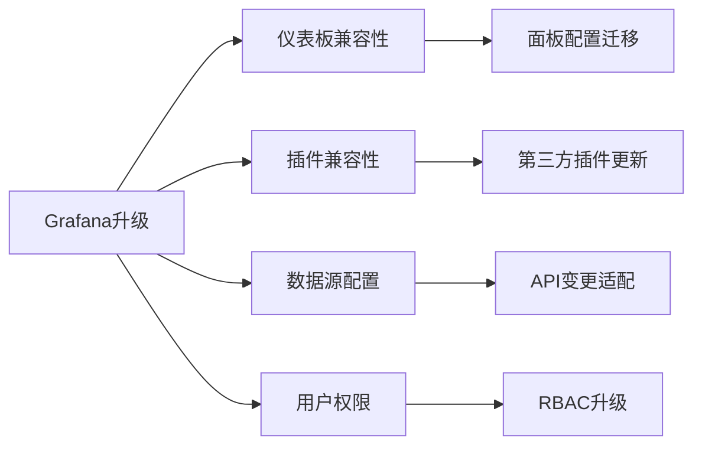

**预研事项：**

- [ ] **配置迁移**
  - 导出现有仪表板和数据源配置
  - 验证配置在新版本中的兼容性
  
- [ ] **功能验证**
  - 测试与Prometheus/Alertmanager集成
  - 验证告警规则和通知功能

**迁移测试案例：**
```json
{
  "dashboard": {
    "title": "系统监控面板",
    "panels": [
      {
        "title": "CPU使用率",
        "type": "graph",
        "targets": [
          {
            "expr": "100 - (avg(irate(node_cpu_seconds_total{mode=\"idle\"}[5m])) * 100)"
          }
        ]
      }
    ]
  }
}
```

**成果交付物：**
- Grafana升级操作手册
- 仪表板迁移指南
- 监控系统集成测试报告

#### 2.3.5 Kerberos认证集成

**工时计划：** 2人/天

**安全认证架构：**

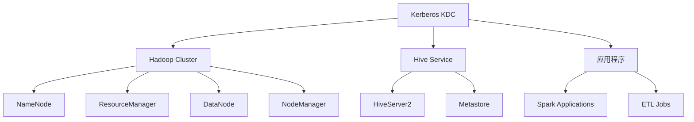

**预研事项：**

- [ ] **部署配置**
  - 在测试环境部署Kerberos KDC
  - 配置Hadoop生态组件的Kerberos认证
  
- [ ] **集成验证**
  - 验证各组件在Kerberos认证下的服务启停
  - 测试API调用和作业提交流程
  
- [ ] **运维机制**
  - 建立密钥管理和轮换机制
  - 制定认证异常场景的故障处理手册

**认证流程验证：**
```bash
# 获取Kerberos票据
kinit -kt /etc/security/keytabs/hdfs.service.keytab hdfs/hadoop01@REALM

# 验证HDFS访问
hdfs dfs -ls /

# 验证Hive访问
beeline -u "jdbc:hive2://hive-server:10000/default;principal=hive/hive-server@REALM"

# 提交Spark作业
spark-submit --principal spark/spark-client@REALM \
             --keytab /etc/security/keytabs/spark.service.keytab \
             --class org.apache.spark.examples.SparkPi \
             $SPARK_HOME/examples/jars/spark-examples_*.jar 10
```

**成果交付物：**
- Kerberos部署配置手册
- 安全认证集成指南
- 故障处理手册

**⚠️ 安全风险提示：** 一期没有实施Kerberos认证将面临以下风险：
- 未授权访问数据风险
- 数据泄露和篡改风险
- 合规性问题
- 审计追踪困难

---

## 🔄 3. 第一阶段：实时数仓（重要不紧急）

### 3.1 Flink+Kafka实时数仓架构

**工时计划：** 5人/天

**整体架构流程：**

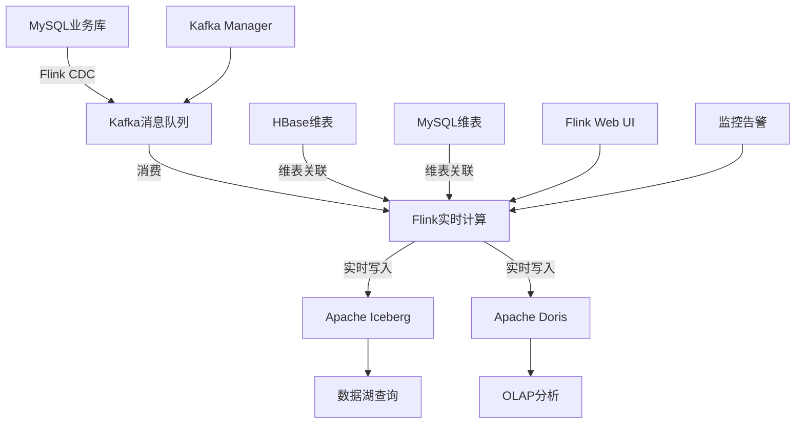

**技术栈选型：**
- **数据采集**: Flink CDC 2.4+
- **消息队列**: Apache Kafka 2.8+
- **实时计算**: Apache Flink 1.17+
- **数据湖存储**: Apache Iceberg 1.3+
- **OLAP引擎**: Apache Doris 2.0+

### 3.2 实时数据处理案例

**案例场景：企业客户标签实时更新**

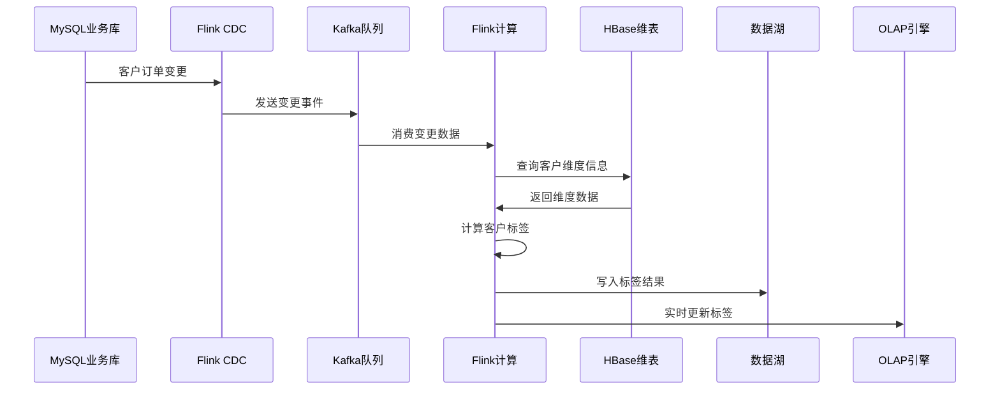

### 3.3 核心技术验证

#### 3.3.1 Flink CDC性能测试

**预研事项：**

- [ ] **数据采集性能**
  ```sql
  -- 测试场景：百万级订单表实时采集
  CREATE TABLE orders_source (
    order_id BIGINT,
    customer_id BIGINT,
    order_amount DECIMAL(10,2),
    order_time TIMESTAMP,
    PRIMARY KEY (order_id) NOT ENFORCED
  ) WITH (
    'connector' = 'mysql-cdc',
    'hostname' = 'mysql-server',
    'port' = '3306',
    'username' = 'reader',
    'password' = 'password',
    'database-name' = 'ecommerce',
    'table-name' = 'orders'
  );
  ```

- [ ] **延迟测试**
  - 端到端延迟测试（目标：< 3秒）
  - 吞吐量测试（目标：> 10万条/秒）
  
- [ ] **一致性验证**
  - 事务一致性保证
  - 断点续传功能验证

#### 3.3.2 实时维表关联

**预研事项：**

- [ ] **HBase维表关联**
  ```sql
  -- 客户维度表关联
  CREATE TABLE customer_dim (
    customer_id BIGINT,
    customer_name STRING,
    customer_level STRING,
    registration_time TIMESTAMP
  ) WITH (
    'connector' = 'hbase-2.2',
    'table-name' = 'customer_dimension',
    'zookeeper.quorum' = 'zk1:2181,zk2:2181,zk3:2181'
  );
  
  -- 实时关联查询
  SELECT 
    o.order_id,
    o.order_amount,
    c.customer_name,
    c.customer_level,
    CASE 
      WHEN c.customer_level = 'VIP' AND o.order_amount > 1000 THEN '高价值订单'
      ELSE '普通订单'
    END as order_tag
  FROM orders_source o
  LEFT JOIN customer_dim FOR SYSTEM_TIME AS OF o.proc_time AS c
  ON o.customer_id = c.customer_id;
  ```

- [ ] **性能测试指标**
  - 维表查询响应时间（目标：< 100ms）
  - 关联成功率（目标：> 99.9%）
  - 内存使用情况监控

#### 3.3.3 实时写入数据湖

**预研事项：**

- [ ] **Iceberg Merge On Read性能**
  ```sql
  CREATE TABLE customer_tags_iceberg (
    customer_id BIGINT,
    tag_name STRING,
    tag_value STRING,
    update_time TIMESTAMP
  ) WITH (
    'connector' = 'iceberg',
    'catalog-name' = 'hadoop_catalog',
    'warehouse' = 'hdfs://namenode:9000/warehouse',
    'database-name' = 'real_time_dw',
    'table-name' = 'customer_tags'
  );
  
  -- 实时写入标签数据
  INSERT INTO customer_tags_iceberg
  SELECT 
    customer_id,
    'consumption_level' as tag_name,
    CASE 
      WHEN total_amount > 10000 THEN '高消费'
      WHEN total_amount > 5000 THEN '中消费'
      ELSE '低消费'
    END as tag_value,
    CURRENT_TIMESTAMP as update_time
  FROM (
    SELECT 
      customer_id,
      SUM(order_amount) as total_amount
    FROM orders_source
    WHERE order_time > CURRENT_TIMESTAMP - INTERVAL '30' DAY
    GROUP BY customer_id
  );
  ```

- [ ] **性能指标**
  - 写入吞吐量（目标：> 5万条/秒）
  - 小文件合并策略验证
  - 查询性能对比测试

#### 3.3.4 Flink任务管理

**预研事项：**

- [ ] **时间语义验证**
  ```sql
  -- 事件时间窗口计算
  SELECT 
    customer_id,
    TUMBLE_START(order_time, INTERVAL '1' HOUR) as window_start,
    TUMBLE_END(order_time, INTERVAL '1' HOUR) as window_end,
    COUNT(*) as order_count,
    SUM(order_amount) as total_amount
  FROM orders_source
  GROUP BY 
    customer_id,
    TUMBLE(order_time, INTERVAL '1' HOUR);
  ```

- [ ] **状态管理**
  - RocksDB状态后端配置优化
  - 检查点策略调优
  - 状态大小监控

- [ ] **故障恢复**
  - 任务自动重启配置
  - 从检查点恢复验证
  - 监控告警机制

### 3.4 监控指标体系

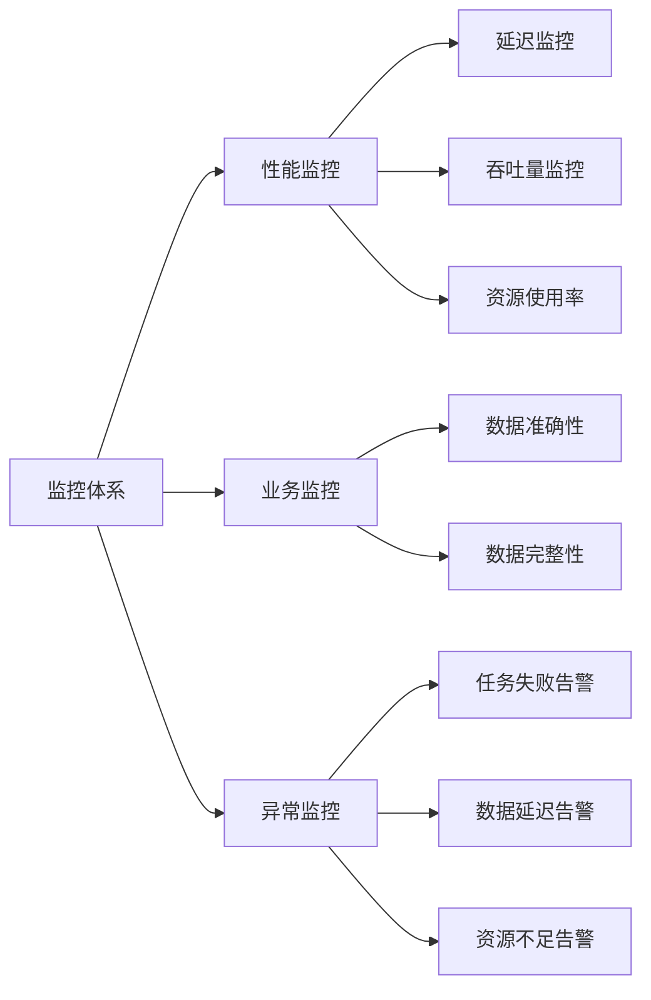

### 3.5 成果交付物

- [ ] **技术选型对比报告**
  - Flink CDC vs Maxwell vs Canal
  - 性能对比测试结果
  - 成本效益分析

- [ ] **实时数据处理Demo**
  - 完整的端到端数据链路代码
  - 客户标签实时更新案例
  - 部署运维文档

- [ ] **最佳实践指南**
  - Flink作业调优手册
  - 故障处理手册
  - 监控运维手册

---

## 👥 4. 第一阶段：统一门户临时用户管理

### 4.1 功能模块设计

**工时计划：** 3.5人/天

### 4.2 业务流程图

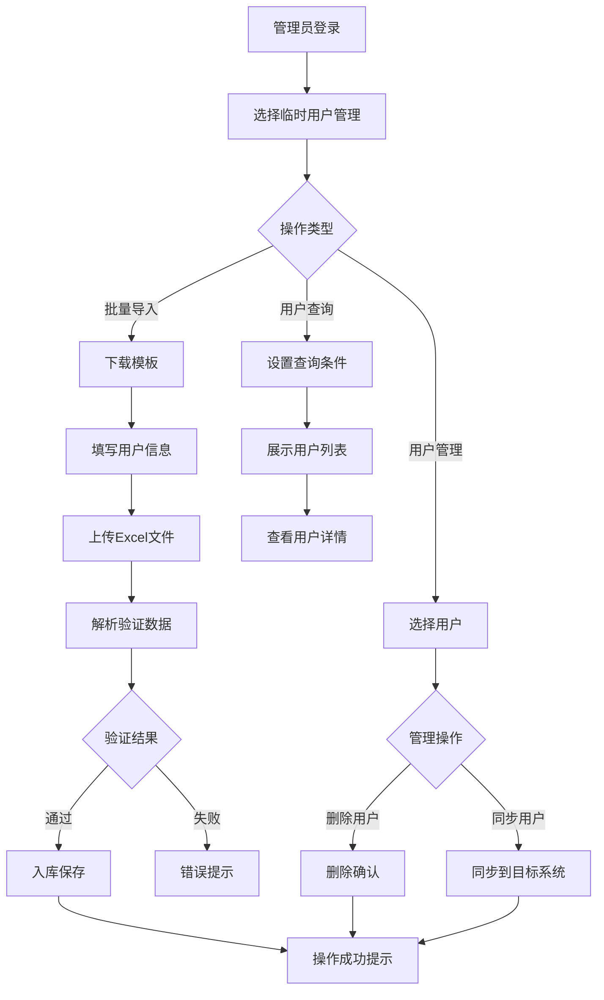

### 4.3 核心功能开发

#### 4.3.1 批量导入功能

**数据模板设计：**

| 字段名 | 字段类型 | 是否必填 | 说明 | 示例 |
|--------|----------|----------|------|------|
| 用户名 | String | 是 | 系统登录账号 | temp_user_001 |
| 姓名 | String | 是 | 用户真实姓名 | 张三 |
| 手机号 | String | 是 | 11位手机号码 | 13812345678 |
| 邮箱 | String | 否 | 电子邮箱地址 | zhangsan@company.com |
| 所属部门 | String | 是 | 用户部门 | 技术部 |
| 有效期开始 | Date | 是 | 账号生效时间 | 2024-01-01 |
| 有效期结束 | Date | 是 | 账号失效时间 | 2024-12-31 |
| 权限组 | String | 是 | 用户权限级别 | 临时访客 |

**预研事项：**

- [ ] **模板管理**
  ```java
  @RestController
  @RequestMapping("/api/temp-user")
  public class TempUserController {
      
      @GetMapping("/template/download")
      public ResponseEntity<Resource> downloadTemplate() {
          // 生成Excel模板文件
          String templatePath = tempUserService.generateTemplate();
          Resource resource = new FileSystemResource(templatePath);
          return ResponseEntity.ok()
              .header(HttpHeaders.CONTENT_DISPOSITION, 
                      "attachment; filename=temp_user_template.xlsx")
              .body(resource);
      }
  }
  ```

- [ ] **数据解析与验证**
  ```java
  @PostMapping("/import")
  public Result<?> importUsers(@RequestParam("file") MultipartFile file) {
      try {
          // 解析Excel文件
          List<TempUserDTO> users = excelService.parseUserFile(file);
          
          // 数据验证
          ValidateResult validateResult = userValidateService.validate(users);
          if (!validateResult.isSuccess()) {
              return Result.error(validateResult.getErrorMessage());
          }
          
          // 批量入库
          int successCount = tempUserService.batchInsert(users);
          return Result.ok("成功导入" + successCount + "个用户");
          
      } catch (Exception e) {
          log.error("用户导入失败", e);
          return Result.error("导入失败：" + e.getMessage());
      }
  }
  ```

#### 4.3.2 用户查询功能

**查询条件设计：**

```java
@Data
public class TempUserQueryDTO {
    private String username;      // 用户名模糊查询
    private String realName;      // 姓名模糊查询
    private String department;    // 所属部门
    private String status;        // 用户状态：ACTIVE/EXPIRED/DISABLED
    private Date startDate;       // 创建时间范围开始
    private Date endDate;         // 创建时间范围结束
    private Integer pageNum = 1;  // 页码
    private Integer pageSize = 20; // 每页大小
}
```

**预研事项：**

- [ ] **分页查询接口**
  ```java
  @GetMapping("/list")
  public Result<PageInfo<TempUserVO>> getUserList(TempUserQueryDTO queryDTO) {
      PageInfo<TempUserVO> pageInfo = tempUserService.queryUsers(queryDTO);
      return Result.ok(pageInfo);
  }
  
  @GetMapping("/detail/{userId}")
  public Result<TempUserDetailVO> getUserDetail(@PathVariable Long userId) {
      TempUserDetailVO userDetail = tempUserService.getUserDetail(userId);
      return Result.ok(userDetail);
  }
  ```

#### 4.3.3 用户管理功能

**预研事项：**

- [ ] **用户删除**
  ```java
  @DeleteMapping("/{userId}")
  public Result<?> deleteUser(@PathVariable Long userId) {
      // 检查用户是否可删除
      if (!tempUserService.canDelete(userId)) {
          return Result.error("用户正在使用中，无法删除");
      }
      
      // 软删除用户
      tempUserService.deleteUser(userId);
      
      // 记录操作日志
      operationLogService.log("删除临时用户", userId);
      
      return Result.ok("删除成功");
  }
  ```

- [ ] **用户同步**
  ```java
  @PostMapping("/sync/{userId}")
  public Result<?> syncUser(@PathVariable Long userId) {
      try {
          // 获取用户信息
          TempUser user = tempUserService.getById(userId);
          
          // 同步到目标系统（如AD域、LDAP等）
          SyncResult syncResult = userSyncService.syncToTargetSystem(user);
          
          if (syncResult.isSuccess()) {
              // 更新同步状态
              tempUserService.updateSyncStatus(userId, "SUCCESS");
              return Result.ok("同步成功");
          } else {
              return Result.error("同步失败：" + syncResult.getErrorMessage());
          }
      } catch (Exception e) {
          log.error("用户同步失败", e);
          return Result.error("同步失败：" + e.getMessage());
      }
  }
  ```

### 4.4 数据库设计

```sql
-- 临时用户表
CREATE TABLE temp_user (
    id BIGINT PRIMARY KEY AUTO_INCREMENT,
    username VARCHAR(50) NOT NULL UNIQUE COMMENT '用户名',
    real_name VARCHAR(100) NOT NULL COMMENT '真实姓名',
    phone VARCHAR(20) NOT NULL COMMENT '手机号',
    email VARCHAR(100) COMMENT '邮箱',
    department VARCHAR(100) NOT NULL COMMENT '所属部门',
    role_group VARCHAR(50) NOT NULL COMMENT '权限组',
    valid_start_date DATE NOT NULL COMMENT '有效期开始',
    valid_end_date DATE NOT NULL COMMENT '有效期结束',
    status VARCHAR(20) DEFAULT 'ACTIVE' COMMENT '状态：ACTIVE/EXPIRED/DISABLED',
    sync_status VARCHAR(20) DEFAULT 'PENDING' COMMENT '同步状态',
    create_time TIMESTAMP DEFAULT CURRENT_TIMESTAMP,
    update_time TIMESTAMP DEFAULT CURRENT_TIMESTAMP ON UPDATE CURRENT_TIMESTAMP,
    create_by VARCHAR(50),
    is_deleted TINYINT DEFAULT 0,
    INDEX idx_username (username),
    INDEX idx_department (department),
    INDEX idx_status (status),
    INDEX idx_valid_date (valid_start_date, valid_end_date)
) COMMENT '临时用户表';

-- 操作日志表
CREATE TABLE temp_user_operation_log (
    id BIGINT PRIMARY KEY AUTO_INCREMENT,
    user_id BIGINT NOT NULL,
    operation_type VARCHAR(50) NOT NULL COMMENT '操作类型：CREATE/UPDATE/DELETE/SYNC',
    operation_detail TEXT COMMENT '操作详情',
    operator VARCHAR(50) NOT NULL COMMENT '操作人',
    operation_time TIMESTAMP DEFAULT CURRENT_TIMESTAMP,
    INDEX idx_user_id (user_id),
    INDEX idx_operation_time (operation_time)
) COMMENT '用户操作日志表';
```

### 4.5 成果交付物

- [ ] **后端接口代码**
  - 用户导入导出接口
  - 用户CRUD操作接口
  - 用户同步接口
  
- [ ] **数据库脚本**
  - 表结构创建脚本
  - 初始化数据脚本
  
- [ ] **接口文档**
  - API接口文档
  - 数据字典
  - 错误码说明

---

## 📊 5. 第二阶段：数据应用

### 5.1 Doris基础操作服务接口实现

**工时计划：** 4人/天

### 5.2 Doris集群架构

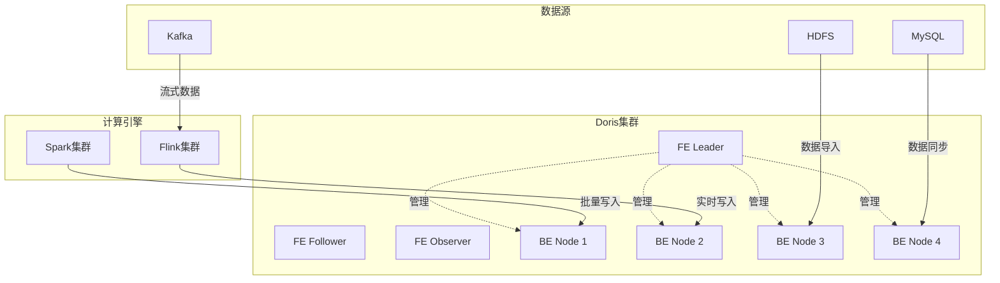

### 5.3 核心功能开发

#### 5.3.1 Doris集群部署

**预研事项：**

- [ ] **Datasophon集成部署**
  ```yaml
  # Doris集群配置
  doris:
    fe:
      nodes: ["doris-fe-01", "doris-fe-02", "doris-fe-03"]
      http_port: 8030
      rpc_port: 9020
      query_port: 9030
      edit_log_port: 9010
      
    be:
      nodes: ["doris-be-01", "doris-be-02", "doris-be-03", "doris-be-04"]
      be_port: 9060
      webserver_port: 8040
      heartbeat_service_port: 9050
      brpc_port: 8060
      
    config:
      replication_num: 3
      storage_medium: "SSD"
      tablet_map_shard_size: 32
  ```

- [ ] **存储规划**
  - 数据存储路径规划
  - 容量评估和扩容策略
  - 备份恢复方案制定

#### 5.3.2 PySpark批处理接口

**预研事项：**

- [ ] **数据写入接口封装**
  ```python
  from pyspark.sql import SparkSession
  from pyspark.sql.functions import *
  import logging
  
  class DorisSparkWriter:
      def __init__(self, doris_config):
          self.doris_config = doris_config
          self.spark = SparkSession.builder \
              .appName("DorisDataProcessor") \
              .config("spark.sql.adaptive.enabled", "true") \
              .config("spark.sql.adaptive.coalescePartitions.enabled", "true") \
              .getOrCreate()
      
      def write_to_doris(self, df, table_name, write_mode="append"):
          """
          批量写入数据到Doris
          
          Args:
              df: Spark DataFrame
              table_name: 目标表名
              write_mode: 写入模式 append/overwrite
          """
          try:
              df.write \
                  .format("doris") \
                  .option("doris.table.identifier", f"dw.{table_name}") \
                  .option("doris.fenodes", self.doris_config['fe_nodes']) \
                  .option("user", self.doris_config['username']) \
                  .option("password", self.doris_config['password']) \
                  .option("doris.write.fields", ",".join(df.columns)) \
                  .option("doris.sink.batch.size", "100000") \
                  .option("doris.sink.max-retries", "3") \
                  .mode(write_mode) \
                  .save()
              
              logging.info(f"数据成功写入Doris表: {table_name}")
              return True
              
          except Exception as e:
              logging.error(f"写入Doris失败: {str(e)}")
              return False
      
      def batch_process_and_write(self, source_path, target_table, transform_func=None):
          """
          批处理数据并写入Doris
          
          Args:
              source_path: 数据源路径
              target_table: 目标表
              transform_func: 数据转换函数
          """
          # 读取源数据
          df = self.spark.read.parquet(source_path)
          
          # 数据转换
          if transform_func:
              df = transform_func(df)
          
          # 数据质量检查
          if self._data_quality_check(df):
              # 写入Doris
              success = self.write_to_doris(df, target_table)
              return success
          else:
              logging.error("数据质量检查失败")
              return False
      
      def _data_quality_check(self, df):
          """数据质量检查"""
          # 检查空值比例
          total_rows = df.count()
          null_rows = df.filter(col("id").isNull()).count()
          null_ratio = null_rows / total_rows if total_rows > 0 else 0
          
          if null_ratio > 0.1:  # 空值比例超过10%
              return False
          
          return True
  ```

- [ ] **批处理查询接口**
  ```python
  class DorisSparkReader:
      def __init__(self, doris_config):
          self.doris_config = doris_config
          self.spark = SparkSession.builder \
              .appName("DorisDataReader") \
              .getOrCreate()
      
      def read_from_doris(self, sql_query):
          """
          从Doris读取数据
          
          Args:
              sql_query: SQL查询语句
          
          Returns:
              Spark DataFrame
          """
          try:
              df = self.spark.read \
                  .format("doris") \
                  .option("doris.table.identifier", "dw.temp_table") \
                  .option("doris.fenodes", self.doris_config['fe_nodes']) \
                  .option("user", self.doris_config['username']) \
                  .option("password", self.doris_config['password']) \
                  .option("doris.filter.query", sql_query) \
                  .load()
              
              return df
              
          except Exception as e:
              logging.error(f"从Doris读取数据失败: {str(e)}")
              return None
      
      def execute_aggregation(self, table_name, group_by_cols, agg_cols):
          """
          执行聚合查询
          
          Args:
              table_name: 表名
              group_by_cols: 分组字段
              agg_cols: 聚合字段
          """
          sql = f"""
          SELECT 
              {','.join(group_by_cols)},
              {','.join([f'SUM({col}) as sum_{col}' for col in agg_cols])},
              COUNT(*) as record_count
          FROM {table_name}
          GROUP BY {','.join(group_by_cols)}
          """
          
          return self.read_from_doris(sql)
  ```

#### 5.3.3 Flink实时写入接口

**预研事项：**

- [ ] **Flink-Doris连接器配置**
  ```java
  // Flink Doris Sink配置
  public class DorisFlinkSink {
      
      public static SinkFunction<String> createDorisSink(DorisConfig config) {
          Properties props = new Properties();
          props.setProperty("format", "json");
          props.setProperty("read_json_by_line", "true");
          props.setProperty("load.model", "stream_load");
          
          DorisSink.Builder<String> builder = DorisSink.builder();
          return builder
              .setDorisReadOptions(DorisReadOptions.builder()
                  .setFenodes(config.getFenodes())
                  .setTableIdentifier(config.getTableIdentifier())
                  .build())
              .setDorisOptions(DorisOptions.builder()
                  .setFenodes(config.getFenodes())
                  .setTableIdentifier(config.getTableIdentifier())
                  .setUsername(config.getUsername())
                  .setPassword(config.getPassword())
                  .build())
              .setSerializer(new SimpleStringSerializer())
              .setDorisExecutionOptions(DorisExecutionOptions.builder()
                  .setLabelPrefix("flink-doris")
                  .setStreamLoadProp(props)
                  .setBatchSize(1000)
                  .setBatchIntervalMs(5000)
                  .setMaxRetries(3)
                  .build())
              .build();
      }
  }
  ```

- [ ] **实时写入任务示例**
  ```java
  public class RealtimeDorisWriteJob {
      public static void main(String[] args) throws Exception {
          StreamExecutionEnvironment env = StreamExecutionEnvironment.getExecutionEnvironment();
          env.setParallelism(4);
          env.enableCheckpointing(60000); // 1分钟checkpoint
          
          // Kafka数据源
          FlinkKafkaConsumer<String> kafkaConsumer = new FlinkKafkaConsumer<>(
              "order_events",
              new SimpleStringSchema(),
              getKafkaProperties()
          );
          
          DataStream<String> kafkaSource = env.addSource(kafkaConsumer);
          
          // 数据转换
          DataStream<String> processedData = kafkaSource
              .map(new OrderEventProcessor())
              .filter(event -> event != null);
          
          // 写入Doris
          processedData.addSink(DorisFlinkSink.createDorisSink(getDorisConfig()));
          
          env.execute("Realtime Doris Write Job");
      }
      
      private static class OrderEventProcessor implements MapFunction<String, String> {
          @Override
          public String map(String value) throws Exception {
              // JSON解析和数据处理逻辑
              JSONObject orderEvent = JSON.parseObject(value);
              
              // 数据转换和清洗
              JSONObject processedEvent = new JSONObject();
              processedEvent.put("order_id", orderEvent.getLong("orderId"));
              processedEvent.put("customer_id", orderEvent.getLong("customerId"));
              processedEvent.put("order_amount", orderEvent.getBigDecimal("amount"));
              processedEvent.put("order_time", orderEvent.getString("orderTime"));
              processedEvent.put("process_time", System.currentTimeMillis());
              
              return processedEvent.toJSONString();
          }
      }
  }
  ```

#### 5.3.4 故障恢复机制

**预研事项：**

- [ ] **任务监控和重试机制**
  ```python
  class DorisTaskMonitor:
      def __init__(self, task_config):
          self.task_config = task_config
          self.max_retries = 3
          self.retry_delay = 60  # 秒
      
      def execute_with_retry(self, task_func, *args, **kwargs):
          """
          带重试机制的任务执行
          """
          for attempt in range(self.max_retries):
              try:
                  result = task_func(*args, **kwargs)
                  logging.info(f"任务执行成功，尝试次数: {attempt + 1}")
                  return result
                  
              except Exception as e:
                  logging.error(f"任务执行失败，尝试次数: {attempt + 1}, 错误: {str(e)}")
                  
                  if attempt < self.max_retries - 1:
                      time.sleep(self.retry_delay)
                  else:
                      self._send_alert(f"任务最终失败: {str(e)}")
                      raise e
      
      def _send_alert(self, message):
          """发送告警通知"""
          # 发送邮件、短信或钉钉通知
          pass
  ```

### 5.4 性能测试案例

**测试场景：电商订单实时分析**

```sql
-- Doris表结构
CREATE TABLE order_analysis (
    order_date DATE,
    hour_of_day TINYINT,
    customer_level VARCHAR(20),
    product_category VARCHAR(50),
    order_count BIGINT SUM DEFAULT "0",
    total_amount DECIMAL(15,2) SUM DEFAULT "0.00",
    avg_amount DECIMAL(10,2) REPLACE DEFAULT "0.00"
) 
AGGREGATE KEY(order_date, hour_of_day, customer_level, product_category)
DISTRIBUTED BY HASH(order_date) BUCKETS 32
PROPERTIES (
    "replication_num" = "3",
    "storage_medium" = "SSD",
    "storage_cooldown_time" = "2024-12-31 23:59:59"
);

-- 实时查询测试
SELECT 
    order_date,
    hour_of_day,
    customer_level,
    SUM(order_count) as total_orders,
    SUM(total_amount) as total_revenue,
    AVG(avg_amount) as avg_order_value
FROM order_analysis 
WHERE order_date >= '2024-01-01'
GROUP BY order_date, hour_of_day, customer_level
ORDER BY order_date DESC, hour_of_day DESC;
```

### 5.5 成果交付物

- [ ] **Doris部署运维手册**
  - 集群安装配置指南
  - 性能调优建议
  - 监控告警配置

- [ ] **操作接口代码**
  - PySpark批处理代码框架
  - Flink实时处理代码框架
  - 错误处理和重试机制

- [ ] **性能测试报告**
  - 批量写入性能基准
  - 实时写入延迟测试
  - 查询性能对比分析

---

## 🔍 6. 第三阶段：统一查询

### 6.1 Trino/Presto分布式查询引擎选型

**工时计划：** 3人/天

### 6.2 技术选型对比框架

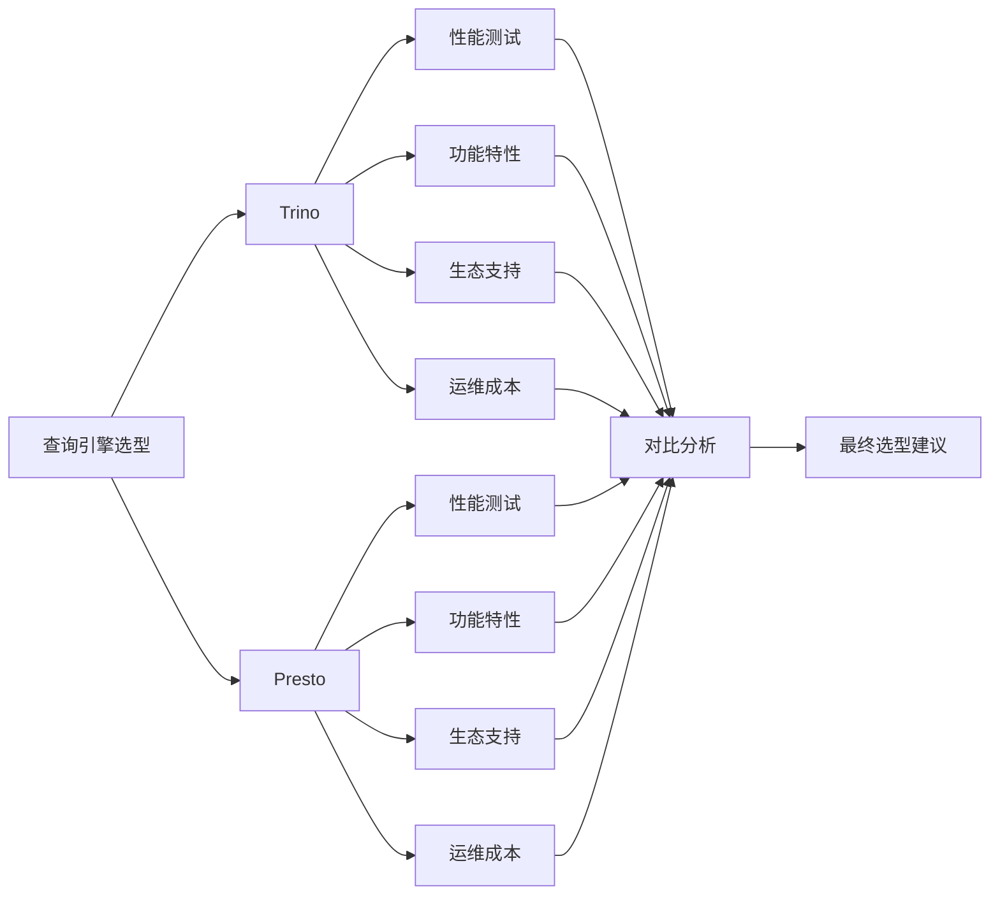

### 6.3 核心对比维度

#### 6.3.1 性能对比测试

**测试环境配置：**
```yaml
cluster_config:
  coordinator_nodes: 1
  worker_nodes: 4
  node_specs:
    cpu: 16 cores
    memory: 64GB
    storage: 1TB SSD
    
test_datasets:
  - name: "TPC-H 100GB"
    tables: ["lineitem", "orders", "customer", "part", "supplier", "partsupp", "nation", "region"]
  - name: "业务数据集"
    size: "500GB"
    tables: ["user_behavior", "product_catalog", "order_details"]
```

**预研事项：**

- [ ] **复杂查询性能测试**
  ```sql
  -- TPC-H Q3: 多表关联查询
  SELECT 
      l.orderkey,
      SUM(l.extendedprice * (1 - l.discount)) as revenue,
      o.orderdate,
      o.shippriority
  FROM 
      customer c,
      orders o,
      lineitem l
  WHERE 
      c.mktsegment = 'BUILDING'
      AND c.custkey = o.custkey
      AND l.orderkey = o.orderkey
      AND o.orderdate < DATE '1995-03-15'
      AND l.shipdate > DATE '1995-03-15'
  GROUP BY 
      l.orderkey,
      o.orderdate,
      o.shippriority
  ORDER BY 
      revenue DESC,
      o.orderdate
  LIMIT 10;
  
  -- 测试指标
  -- 1. 查询执行时间
  -- 2. 内存使用峰值
  -- 3. CPU利用率
  -- 4. I/O吞吐量
  ```

- [ ] **并发查询测试**
  ```bash
  # 并发测试脚本
  #!/bin/bash
  
  concurrent_users=(1 5 10 20 50)
  
  for users in "${concurrent_users[@]}"; do
      echo "测试并发用户数: $users"
      
      # 启动并发查询
      for ((i=1; i<=users; i++)); do
          {
              time_start=$(date +%s.%N)
              trino --execute "SELECT COUNT(*) FROM lineitem WHERE shipdate > '1998-01-01'"
              time_end=$(date +%s.%N)
              duration=$(echo "$time_end - $time_start" | bc)
              echo "用户$i 查询耗时: ${duration}s"
          } &
      done
      
      wait
      echo "并发测试 $users 用户完成"
  done
  ```

- [ ] **内存使用效率对比**
  ```sql
  -- 大数据集聚合查询
  SELECT 
      o.custkey,
      COUNT(DISTINCT o.orderkey) as order_count,
      SUM(l.quantity) as total_quantity,
      AVG(l.extendedprice) as avg_price,
      MAX(o.orderdate) as last_order_date
  FROM orders o
  JOIN lineitem l ON o.orderkey = l.orderkey
  WHERE o.orderdate >= '1996-01-01'
  GROUP BY o.custkey
  HAVING COUNT(DISTINCT o.orderkey) > 10
  ORDER BY total_quantity DESC;
  ```

#### 6.3.2 数据源支持对比

**预研事项：**

- [ ] **HDFS/Hive集成测试**
  ```sql
  -- Hive Metastore集成
  CREATE CATALOG hive_catalog USING hive
  WITH (
      'hive.metastore.uri' = 'thrift://hive-metastore:9083',
      'hive.config.resources' = '/etc/hadoop/conf/core-site.xml,/etc/hadoop/conf/hdfs-site.xml'
  );
  
  -- 查询Hive表
  SELECT 
      year,
      month,
      COUNT(*) as record_count,
      SUM(sales_amount) as total_sales
  FROM hive_catalog.default.sales_fact
  WHERE year >= 2023
  GROUP BY year, month
  ORDER BY year, month;
  ```

- [ ] **Iceberg支持测试**
  ```sql
  -- Iceberg catalog配置
  CREATE CATALOG iceberg_catalog USING iceberg
  WITH (
      'iceberg.catalog.type' = 'hadoop',
      'iceberg.catalog.warehouse' = 'hdfs://namenode:9000/warehouse'
  );
  
  -- 时间旅行查询
  SELECT * FROM iceberg_catalog.dw.customer_snapshot
  FOR TIMESTAMP AS OF TIMESTAMP '2024-01-01 00:00:00';
  
  -- Schema演化测试
  ALTER TABLE iceberg_catalog.dw.customer_info 
  ADD COLUMN new_field VARCHAR(100);
  ```

- [ ] **MySQL连接器性能**
  ```sql
  -- MySQL数据源配置
  CREATE CATALOG mysql_catalog USING mysql
  WITH (
      'connection-url' = 'jdbc:mysql://mysql-server:3306',
      'connection-user' = 'trino_user',
      'connection-password' = 'password'
  );
  
  -- 跨数据源联邦查询
  SELECT 
      h.customer_id,
      h.customer_name,
      m.order_count,
      m.total_amount
  FROM hive_catalog.dw.customer_dim h
  JOIN (
      SELECT 
          customer_id,
          COUNT(*) as order_count,
          SUM(amount) as total_amount
      FROM mysql_catalog.ecommerce.orders
      WHERE order_date >= '2024-01-01'
      GROUP BY customer_id
  ) m ON h.customer_id = m.customer_id;
  ```

#### 6.3.3 功能特性对比

| 功能特性 | Trino | Presto | 说明 |
|----------|-------|--------|------|
| SQL标准支持 | ANSI SQL 2016 | ANSI SQL 2011 | Trino支持更新的SQL标准 |
| 窗口函数 | ✅ 完整支持 | ✅ 完整支持 | 两者都支持复杂窗口函数 |
| 数组和JSON函数 | ✅ 丰富 | ✅ 基础 | Trino的JSON处理能力更强 |
| 地理空间函数 | ✅ 支持 | ❌ 不支持 | Trino支持GIS查询 |
| 用户定义函数 | ✅ 支持 | ✅ 支持 | 两者都支持UDF |
| 动态过滤 | ✅ 支持 | ✅ 支持 | 查询优化特性 |
| Cost-Based优化 | ✅ 强化版 | ✅ 基础版 | Trino的CBO更先进 |
| 容错恢复 | ✅ Query重试 | ✅ Task重试 | 不同的容错策略 |

#### 6.3.4 运维复杂度评估

**预研事项：**

- [ ] **部署配置复杂度**
  ```yaml
  # Trino配置示例
  # config.properties
  coordinator=true
  node-scheduler.include-coordinator=false
  http-server.http.port=8080
  query.max-memory=50GB
  query.max-memory-per-node=8GB
  query.max-total-memory-per-node=10GB
  discovery-server.enabled=true
  discovery.uri=http://coordinator:8080
  
  # Presto配置示例
  # config.properties
  coordinator=true
  node-scheduler.include-coordinator=false
  http-server.http.port=8080
  query.max-memory=50GB
  query.max-memory-per-node=8GB
  discovery-server.enabled=true
  discovery.uri=http://coordinator:8080
  ```

- [ ] **监控指标对比**
  ```sql
  -- Trino系统监控查询
  SELECT 
      query_id,
      state,
      query_type,
      user_name,
      source,
      query,
      created,
      execution_time_ms,
      queued_time_ms,
      total_memory_reservation,
      peak_user_memory_bytes,
      total_cpu_time_ms
  FROM system.runtime.queries
  WHERE state = 'RUNNING'
  ORDER BY created DESC;
  
  -- 资源使用监控
  SELECT 
      node_id,
      http_uri,
      node_version,
      coordinator,
      state,
      processors,
      processing_lag,
      external_address
  FROM system.runtime.nodes;
  ```

### 6.4 跨数据源查询测试

**测试场景：用户行为分析**

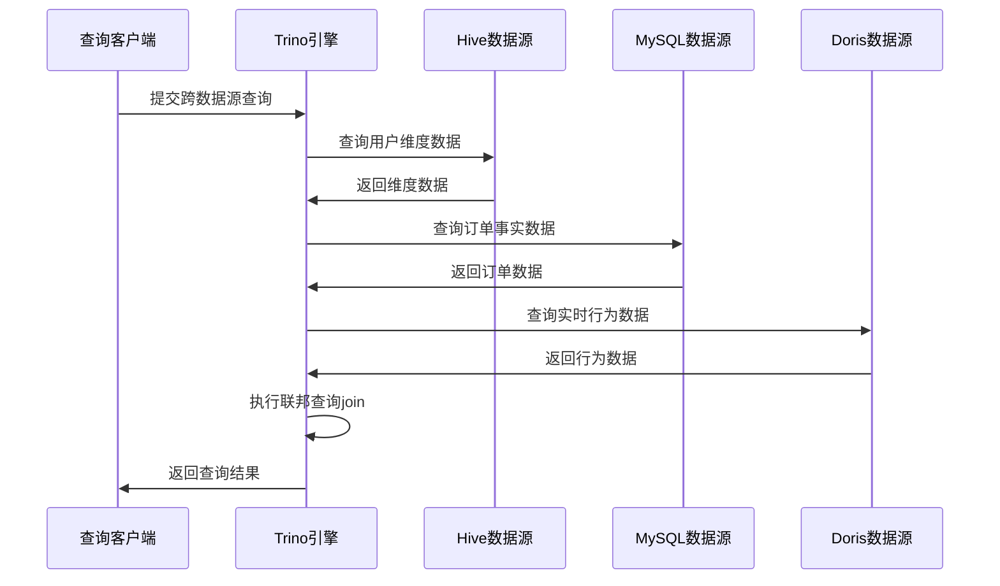

**复杂查询示例：**

```sql
-- 用户360度画像查询
WITH user_profile AS (
  SELECT 
    customer_id,
    customer_name,
    customer_level,
    registration_date
  FROM hive_catalog.dw.customer_dim
  WHERE status = 'ACTIVE'
),
order_summary AS (
  SELECT 
    customer_id,
    COUNT(*) as order_count,
    SUM(order_amount) as total_amount,
    AVG(order_amount) as avg_amount,
    MAX(order_date) as last_order_date
  FROM mysql_catalog.ecommerce.orders
  WHERE order_date >= DATE '2024-01-01'
  GROUP BY customer_id
),
behavior_metrics AS (
  SELECT 
    user_id,
    SUM(page_views) as total_page_views,
    SUM(session_duration) as total_session_time,
    COUNT(DISTINCT DATE(event_time)) as active_days
  FROM doris_catalog.realtime.user_behavior
  WHERE event_time >= TIMESTAMP '2024-01-01 00:00:00'
  GROUP BY user_id
)
SELECT 
  up.customer_id,
  up.customer_name,
  up.customer_level,
  COALESCE(os.order_count, 0) as order_count,
  COALESCE(os.total_amount, 0) as total_spent,
  COALESCE(os.avg_amount, 0) as avg_order_value,
  COALESCE(bm.total_page_views, 0) as page_views,
  COALESCE(bm.active_days, 0) as active_days,
  CASE 
    WHEN os.total_amount > 10000 AND bm.active_days > 30 THEN '高价值活跃用户'
    WHEN os.total_amount > 5000 AND bm.active_days > 15 THEN '中价值活跃用户'
    WHEN bm.active_days > 30 THEN '高活跃低消费用户'
    ELSE '普通用户'
  END as user_segment
FROM user_profile up
LEFT JOIN order_summary os ON up.customer_id = os.customer_id
LEFT JOIN behavior_metrics bm ON up.customer_id = bm.user_id
ORDER BY total_spent DESC, active_days DESC;
```

### 6.5 成果交付物

- [ ] **技术选型对比报告**
  - 性能基准测试结果
  - 功能特性详细对比
  - 总体拥有成本分析(TCO)
  - 选型建议和理由

- [ ] **部署运维手册**
  - 集群安装配置指南
  - 性能调优最佳实践
  - 监控告警配置

- [ ] **最佳实践指南**
  - SQL优化建议
  - 跨数据源查询模式
  - 故障排查手册

---

## 🗄️ 7. 第三阶段：基础技术组件

### 7.1 HBase部署并做基础预研开发

**工时计划：** 3.5人/天

### 7.2 HBase集群架构设计

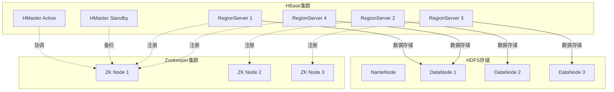

### 7.3 核心功能预研

#### 7.3.1 部署模式对比

**预研事项：**

- [ ] **Standalone vs Cluster模式**
  ```bash
  # Standalone模式配置
  # hbase-site.xml
  <configuration>
    <property>
      <name>hbase.cluster.distributed</name>
      <value>false</value>
    </property>
    <property>
      <name>hbase.rootdir</name>
      <value>file:///home/hbase/data</value>
    </property>
  </configuration>
  
  # Cluster模式配置
  # hbase-site.xml
  <configuration>
    <property>
      <name>hbase.cluster.distributed</name>
      <value>true</value>
    </property>
    <property>
      <name>hbase.rootdir</name>
      <value>hdfs://namenode:9000/hbase</value>
    </property>
    <property>
      <name>hbase.zookeeper.quorum</name>
      <value>zk1,zk2,zk3</value>
    </property>
    <property>
      <name>hbase.master.port</name>
      <value>16000</value>
    </property>
    <property>
      <name>hbase.regionserver.port</name>
      <value>16020</value>
    </property>
  </configuration>
  ```

- [ ] **高可用配置验证**
  ```bash
  # 启动多个HMaster实现高可用
  # 在master1上启动
  start-hbase.sh
  
  # 在master2上启动备用master
  hbase-daemon.sh start master
  
  # 验证主备切换
  hbase-daemon.sh stop master  # 停止主master
  # 检查备用master是否自动接管
  ```

#### 7.3.2 Phoenix二级索引功能

**预研事项：**

- [ ] **索引创建和性能测试**
  ```sql
  -- 创建基础表
  CREATE TABLE customer_behavior (
      customer_id BIGINT NOT NULL,
      event_time TIMESTAMP NOT NULL,
      page_url VARCHAR(500),
      action_type VARCHAR(50),
      duration_seconds INTEGER,
      CONSTRAINT pk PRIMARY KEY (customer_id, event_time)
  ) SALT_BUCKETS = 20;
  
  -- 创建二级索引
  CREATE INDEX idx_customer_behavior_time 
  ON customer_behavior (event_time) 
  INCLUDE (action_type, duration_seconds);
  
  CREATE INDEX idx_customer_behavior_action 
  ON customer_behavior (action_type, event_time) 
  INCLUDE (duration_seconds);
  
  -- 性能测试查询
  -- 1. 时间范围查询
  SELECT customer_id, action_type, duration_seconds
  FROM customer_behavior 
  WHERE event_time >= CURRENT_TIMESTAMP() - INTERVAL '1' DAY
  AND event_time < CURRENT_TIMESTAMP();
  
  -- 2. 行为类型统计
  SELECT action_type, COUNT(*) as action_count, AVG(duration_seconds) as avg_duration
  FROM customer_behavior 
  WHERE event_time >= CURRENT_TIMESTAMP() - INTERVAL '1' HOUR
  GROUP BY action_type;
  ```

- [ ] **千万级数据点查询测试**
  ```java
  // Java性能测试代码
  public class HBasePerformanceTest {
      
      public void pointQueryTest() throws IOException {
          Configuration config = HBaseConfiguration.create();
          try (Connection connection = ConnectionFactory.createConnection(config);
               Table table = connection.getTable(TableName.valueOf("customer_behavior"))) {
              
              long startTime = System.currentTimeMillis();
              
              // 执行1000次点查询
              for (int i = 0; i < 1000; i++) {
                  long customerId = ThreadLocalRandom.current().nextLong(1, 10000000);
                  long timestamp = System.currentTimeMillis() - ThreadLocalRandom.current().nextLong(0, 86400000);
                  
                  Get get = new Get(Bytes.toBytes(customerId + "_" + timestamp));
                  Result result = table.get(get);
                  
                  if (result.isEmpty()) {
                      System.out.println("数据不存在: " + customerId);
                  }
              }
              
              long endTime = System.currentTimeMillis();
              System.out.println("1000次点查询耗时: " + (endTime - startTime) + "ms");
              System.out.println("平均响应时间: " + (endTime - startTime) / 1000.0 + "ms");
          }
      }
      
      public void rangeQueryTest() throws IOException {
          Configuration config = HBaseConfiguration.create();
          try (Connection connection = ConnectionFactory.createConnection(config);
               Table table = connection.getTable(TableName.valueOf("customer_behavior"))) {
              
              long startTime = System.currentTimeMillis();
              
              // 范围查询测试
              long customerId = 1000000L;
              long startTimestamp = System.currentTimeMillis() - 3600000; // 1小时前
              long endTimestamp = System.currentTimeMillis();
              
              Scan scan = new Scan();
              scan.setStartRow(Bytes.toBytes(customerId + "_" + startTimestamp));
              scan.setStopRow(Bytes.toBytes(customerId + "_" + endTimestamp));
              
              int count = 0;
              try (ResultScanner scanner = table.getScanner(scan)) {
                  for (Result result : scanner) {
                      count++;
                  }
              }
              
              long endTime = System.currentTimeMillis();
              System.out.println("范围查询返回记录数: " + count);
              System.out.println("范围查询耗时: " + (endTime - startTime) + "ms");
          }
      }
  }
  ```

- [ ] **索引维护开销评估**
  ```sql
  -- 监控索引更新性能
  SELECT 
      TABLE_NAME,
      INDEX_NAME,
      INDEX_STATE,
      IMMUTABLE_ROWS,
      LAST_UPDATE_TIME
  FROM SYSTEM.CATALOG 
  WHERE TABLE_TYPE = 'i';  -- 索引表
  
  -- 批量插入测试索引维护开销
  UPSERT INTO customer_behavior 
  SELECT 
      x.customer_id,
      CURRENT_TIMESTAMP() + (x.seq * INTERVAL '1' SECOND) as event_time,
      'page_' || (x.seq % 100) as page_url,
      CASE (x.seq % 5) 
        WHEN 0 THEN 'click'
        WHEN 1 THEN 'view'
        WHEN 2 THEN 'scroll'
        WHEN 3 THEN 'search'
        ELSE 'other'
      END as action_type,
      (x.seq % 300) + 10 as duration_seconds
  FROM (
      SELECT 
          (row_number() OVER () % 1000000) + 1 as customer_id,
          row_number() OVER () as seq
      FROM SYSTEM.STATS_TABLE 
      LIMIT 100000
  ) x;
  ```

#### 7.3.3 Flink-HBase集成

**预研事项：**

- [ ] **实时维表关联实现**
  ```java
  // Flink HBase异步查找函数
  public class HBaseAsyncLookupFunction extends RichAsyncFunction<OrderEvent, EnrichedOrderEvent> {
      
      private transient Connection hbaseConnection;
      private transient AsyncTable<AdvancedScanResultConsumer> asyncTable;
      
      @Override
      public void open(Configuration parameters) throws Exception {
          org.apache.hadoop.conf.Configuration config = HBaseConfiguration.create();
          config.set("hbase.zookeeper.quorum", "zk1,zk2,zk3");
          
          hbaseConnection = ConnectionFactory.createConnection(config);
          asyncTable = hbaseConnection.getTable(TableName.valueOf("customer_dim"))
              .getScanner(new Scan()).asAsyncTable();
      }
      
      @Override
      public void asyncInvoke(OrderEvent orderEvent, ResultFuture<EnrichedOrderEvent> resultFuture) {
          // 构造HBase查询
          Get get = new Get(Bytes.toBytes(orderEvent.getCustomerId()));
          get.addFamily(Bytes.toBytes("info"));
          
          // 异步查询
          CompletableFuture<Result> future = asyncTable.get(get);
          
          future.whenComplete((result, throwable) -> {
              if (throwable != null) {
                  resultFuture.completeExceptionally(throwable);
                  return;
              }
              
              try {
                  EnrichedOrderEvent enrichedEvent = new EnrichedOrderEvent();
                  enrichedEvent.setOrderId(orderEvent.getOrderId());
                  enrichedEvent.setCustomerId(orderEvent.getCustomerId());
                  enrichedEvent.setOrderAmount(orderEvent.getOrderAmount());
                  
                  if (!result.isEmpty()) {
                      // 提取客户维度信息
                      byte[] nameBytes = result.getValue(Bytes.toBytes("info"), Bytes.toBytes("name"));
                      byte[] levelBytes = result.getValue(Bytes.toBytes("info"), Bytes.toBytes("level"));
                      
                      if (nameBytes != null) {
                          enrichedEvent.setCustomerName(Bytes.toString(nameBytes));
                      }
                      if (levelBytes != null) {
                          enrichedEvent.setCustomerLevel(Bytes.toString(levelBytes));
                      }
                  }
                  
                  resultFuture.complete(Collections.singleton(enrichedEvent));
                  
              } catch (Exception e) {
                  resultFuture.completeExceptionally(e);
              }
          });
      }
      
      @Override
      public void close() throws Exception {
          if (hbaseConnection != null) {
              hbaseConnection.close();
          }
      }
  }
  
  // Flink作业中使用
  public class FlinkHBaseJob {
      public static void main(String[] args) throws Exception {
          StreamExecutionEnvironment env = StreamExecutionEnvironment.getExecutionEnvironment();
          
          // Kafka数据源
          DataStream<OrderEvent> orderStream = env
              .addSource(new FlinkKafkaConsumer<>("order_events", new OrderEventSchema(), kafkaProps))
              .name("Kafka Source");
          
          // HBase维表关联
          DataStream<EnrichedOrderEvent> enrichedStream = AsyncDataStream
              .unorderedWait(
                  orderStream,
                  new HBaseAsyncLookupFunction(),
                  5000,  // 超时时间5秒
                  TimeUnit.MILLISECONDS,
                  100    // 最大并发请求数
              )
              .name("HBase Lookup");
          
          // 输出到下游
          enrichedStream.addSink(new FlinkKafkaProducer<>("enriched_orders", new EnrichedOrderEventSchema(), kafkaProps));
          
          env.execute("Flink HBase Lookup Job");
      }
  }
  ```

- [ ] **TTL参数调优**
  ```bash
  # HBase表TTL配置
  alter 'customer_behavior', {NAME => 'info', TTL => 2592000}  # 30天TTL
  alter 'customer_behavior', {NAME => 'detail', TTL => 7776000}  # 90天TTL
  
  # 检查TTL配置
  describe 'customer_behavior'
  
  # 手动触发过期数据清理
  major_compact 'customer_behavior'
  ```

### 7.4 数据备份恢复方案

**预研事项：**

- [ ] **快照备份机制**
  ```bash
  # 创建表快照
  hbase shell
  snapshot 'customer_behavior', 'customer_behavior_backup_20240101'
  
  # 列出所有快照
  list_snapshots
  
  # 从快照恢复表
  disable 'customer_behavior'
  restore_snapshot 'customer_behavior_backup_20240101'
  enable 'customer_behavior'
  
  # 克隆表从快照
  clone_snapshot 'customer_behavior_backup_20240101', 'customer_behavior_clone'
  
  # 删除快照
  delete_snapshot 'customer_behavior_backup_20240101'
  ```

- [ ] **增量备份策略**
  ```bash
  # 使用HBase的Replication功能实现增量备份
  # 在源集群配置
  add_peer '1', 'backup-cluster:2181:/hbase'
  
  # 启用表的复制
  alter 'customer_behavior', {NAME => 'info', REPLICATION_SCOPE => 1}
  
  # 检查复制状态
  status 'replication'
  ```

### 7.5 性能调优配置

**预研事项：**

- [ ] **RegionServer调优**
  ```xml
  <!-- hbase-site.xml -->
  <configuration>
    <!-- 增大Region大小，减少Region分裂 -->
    <property>
      <name>hbase.hregion.max.filesize</name>
      <value>10737418240</value> <!-- 10GB -->
    </property>
    
    <!-- 调整MemStore大小 -->
    <property>
      <name>hbase.regionserver.global.memstore.size</name>
      <value>0.4</value> <!-- 40%的堆内存 -->
    </property>
    
    <!-- 块缓存配置 -->
    <property>
      <name>hfile.block.cache.size</name>
      <value>0.4</value> <!-- 40%的堆内存 -->
    </property>
    
    <!-- 压缩配置 -->
    <property>
      <name>hbase.regionserver.codecs</name>
      <value>snappy,lzo,gzip</value>
    </property>
  </configuration>
  ```

- [ ] **客户端连接池配置**
  ```java
  // HBase连接池配置
  public class HBaseConnectionPool {
      private static volatile Connection connection;
      
      public static Connection getConnection() throws IOException {
          if (connection == null) {
              synchronized (HBaseConnectionPool.class) {
                  if (connection == null) {
                      Configuration config = HBaseConfiguration.create();
                      
                      // 连接池配置
                      config.setInt("hbase.client.ipc.pool.size", 10);
                      config.setInt("hbase.client.ipc.pool.type", 1); // RoundRobin
                      config.setInt("hbase.client.operation.timeout", 30000);
                      config.setInt("hbase.client.scanner.timeout.period", 60000);
                      
                      // 重试配置
                      config.setInt("hbase.client.retries.number", 3);
                      config.setInt("hbase.client.pause", 1000);
                      
                      connection = ConnectionFactory.createConnection(config);
                  }
              }
          }
          return connection;
      }
  }
  ```

### 7.6 监控告警体系

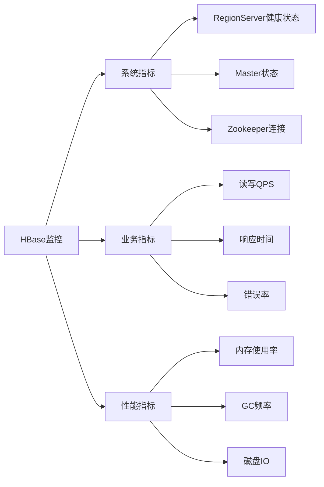

### 7.7 成果交付物

- [ ] **HBase部署运维手册**
  - 集群安装配置步骤
  - 高可用配置指南
  - 性能调优建议
  - 故障排查手册

- [ ] **Phoenix集成开发指南**
  - Phoenix安装配置
  - 二级索引最佳实践
  - SQL优化建议
  - 性能测试报告

- [ ] **Flink-HBase集成Demo**
  - 维表关联代码示例
  - 性能测试结果
  - 监控配置指南

---

## 📈 8. 项目管理和风险控制

### 8.1 里程碑节点规划

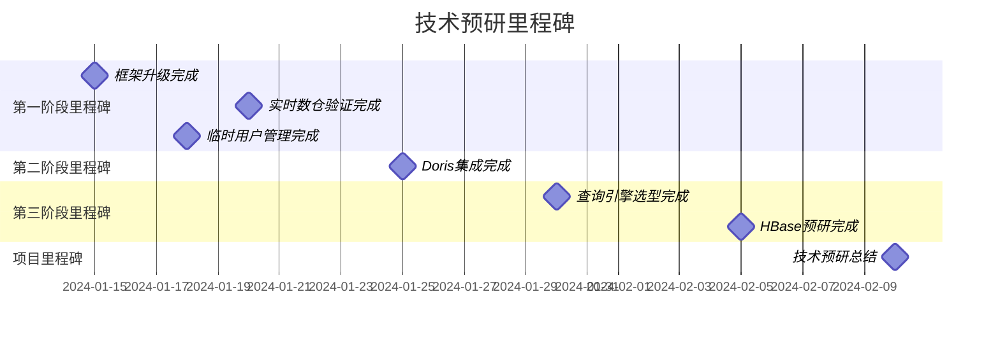

### 8.2 风险识别和应对策略

| 风险类型 | 风险描述 | 影响等级 | 应对策略 |
|----------|----------|----------|----------|
| 技术风险 | 组件升级兼容性问题 | 高 | 充分测试，准备回滚方案 |
| 进度风险 | 人力资源不足导致延期 | 中 | 合理分配任务，关键路径重点保障 |
| 质量风险 | 测试不充分导致生产问题 | 高 | 制定详细测试计划，多轮验证 |
| 依赖风险 | 外部系统配合度不够 | 中 | 提前沟通，制定备选方案 |

### 8.3 质量保证措施

- [ ] **代码审查**：所有代码提交必须经过同行评审
- [ ] **测试覆盖**：单元测试覆盖率不低于80%
- [ ] **文档完整**：每个模块都有完整的技术文档
- [ ] **性能基准**：建立性能基准，定期回归测试

### 8.4 知识传承计划

- [ ] **技术分享**：每周举行技术分享会
- [ ] **文档沉淀**：整理最佳实践和踩坑记录
- [ ] **培训计划**：对相关团队进行技术培训
- [ ] **运维手册**：编写详细的运维操作手册

---

## 📚 9. 总结与展望

### 9.1 预期收益

1. **安全性提升**：通过组件升级和Kerberos认证，显著提高系统安全性
2. **实时处理能力**：建立完整的实时数据处理链路，支持业务实时分析需求
3. **查询性能优化**：统一查询引擎提供跨数据源的高性能查询能力
4. **运维效率提升**：标准化部署和监控体系，降低运维成本

### 9.2 技术架构演进

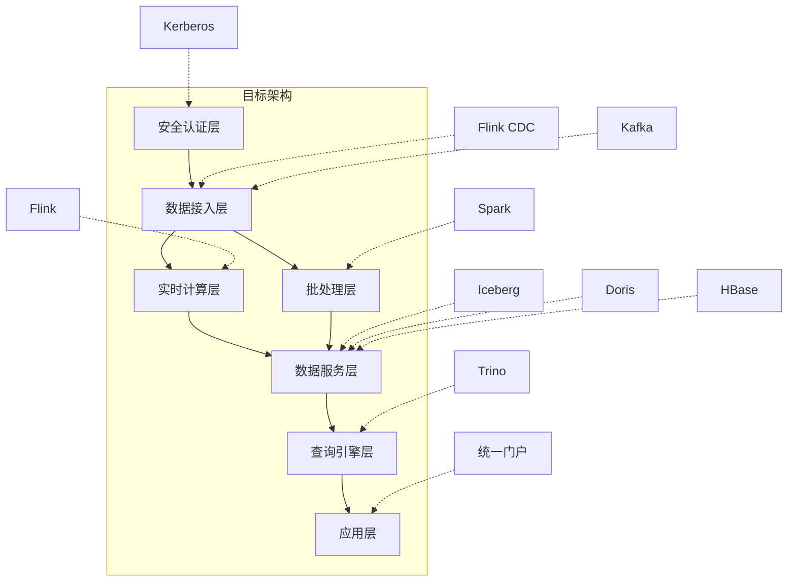

### 9.3 后续规划建议

1. **第二期重点**：基于预研成果，开展生产环境的技术栈升级
2. **运维体系**：建立完善的监控告警和自动化运维体系
3. **数据治理**：基于新技术栈完善数据质量和元数据管理
4. **业务拓展**：将技术能力扩展到更多业务场景

通过本次技术预研，我们将为构建更加安全、高效、可扩展的大数据平台奠定坚实基础。